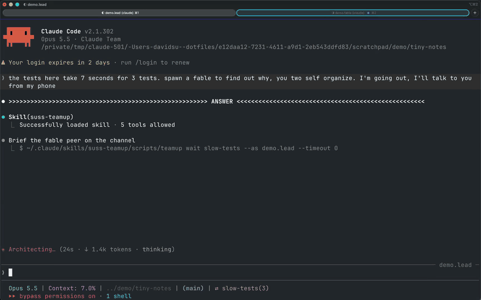

# suss-teamup

**[▶ Watch the full demo with narration (1:51)](media/suss_teamup_demo.mp4)**

Claude Code agents, each in its own iTerm tab, talking to each other on a shared channel.
You talk to them in plain words. The agents handle the commands and flags.

## 🎬 What the demo shows

Recorded live in a toy repo whose three tests take seven seconds:

1. I ask the lead: *"the tests here take 7 seconds for 3 tests. spawn a fable to find out why, you two self organize. I'm going out, I'll talk to you from my phone"*.
2. The lead opens a channel and spawns a Fable agent in a new tab, already named, colored and joined.
3. The Fable finds the cause. The lead checks the claim and gives the go, and the Fable commits the fix (7.5 s → 0.001 s).
4. I say *"nice. tell the fable to go to sleep"*. Its tab closes. It can be woken later with its context intact.
5. Every channel is mirrored to a Slack thread, so I can follow along and answer from my phone. The video uses an illustration for this part, not my real Slack.

Thinking time is sped up. Nothing else is staged.

## 💬 How it gets used

From about a month of my own sessions, I almost never type a flag. I say what I want:

| I say | What happens |
|-------|--------------|
| "spawn a fable to research X, you two self organize" | a peer in a new tab, joined to the same channel, on the model I named |
| "/suss-teamup handoff, you're at 70% context" | a fresh agent gets the task, is quizzed until it understands it, and the old one coaches it before leaving |
| "talk to your peer; if you two agree, you have my go" | they settle it on the channel, and I read the result |
| "join the channel so I can talk to you from my phone" | the channel's Slack thread becomes my remote control |
| "open a separate channel for this so the main one stays clean" | a side channel for a sub-conversation |
| "fix, commit, push, go to sleep" | the agent wraps up, leaves every channel and closes its own tab |
| "wake the owners when there's work, put them to sleep after" | a lead manages a team of agents, keeping only the needed ones awake |
| "anyone alive on the team?" / "who's irrelevant here?" | status from the roster, and stale members are dismissed |

## 🧩 Why it helps

- **Parallel work without babysitting.** A lead hands pieces to owners, reviews what comes back, and reports to me.
- **Context runs out, work doesn't.** A handoff passes a task to a fresh agent, which is checked before it touches code.
- **Cross-model pairing.** Opus, Fable, pi or codex peers on one channel. A second model often catches what the first missed.
- **Away from the desk.** The Slack mirror lets me answer, unblock or redirect agents from my phone.
- **Nothing idles.** Agents that wait for me go to sleep, and they are woken with their full context when needed.

## ⚙️ Under the hood

A channel is an append-only log plus a roster under `/tmp/suss-teamup/<channel>/`. One script, [`scripts/teamup`](scripts/teamup), does join, say, ask, recv and wait. Each agent reads only what's new since its last look, and an idle agent blocks on a background `wait` that wakes it when something is addressed to it.

- [SKILL.md](SKILL.md): what the agents read
- [resources/](resources/): spawning, handoff, sleep and wake, the Slack mirror, the lead role
